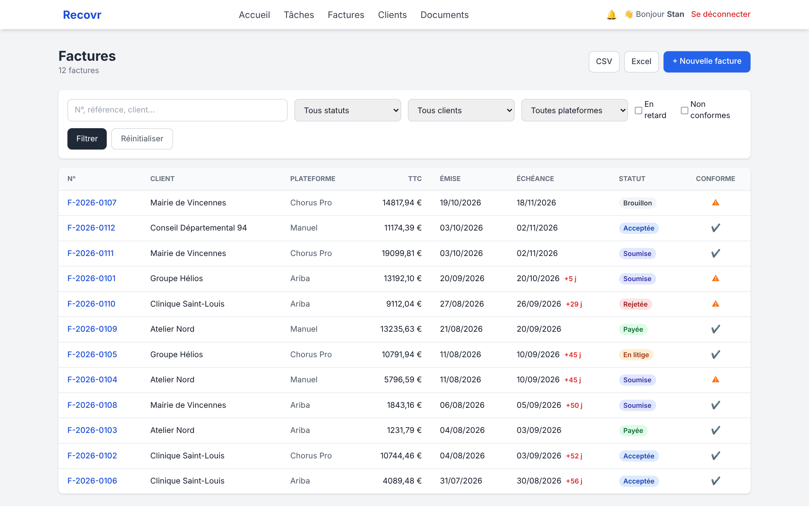
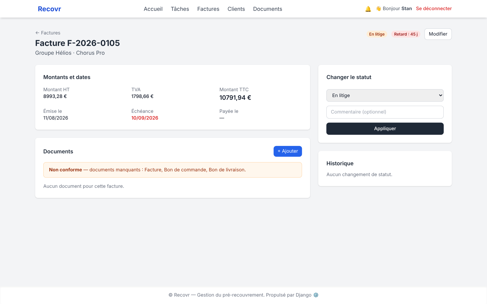

# RecovR

[](https://github.com/stan-kempachi/recovr_software/actions/workflows/ci.yml)
 

Application web de pré-recouvrement : suivi des factures clients, contrôle des pièces justificatives avant dépôt, alertes de retard et exports. Les connecteurs vers les plateformes de facturation (Chorus Pro, Ariba) sont la prochaine étape de la feuille de route.

**Démo** : https://recovr.stan-aria.dev (compte sur demande)

RecovR permet à une entreprise de :
- vérifier que le processus de facturation client est respecté avant dépôt (PO, BL, PV, CRA…) ;
- centraliser le suivi des statuts de factures sur plusieurs plateformes ;
- réduire les délais de paiement et améliorer le recouvrement.





## Stack

| Couche | Choix |
|---|---|
| Backend | Django 4.2, Django REST Framework, django-allauth |
| Frontend | Templates Django + Tailwind CSS (CDN) + DataTables |
| Base de données | PostgreSQL 16 |
| Serveur | gunicorn + whitenoise, derrière un reverse proxy (TLS Cloudflare) |
| Qualité | black, isort, ruff, pre-commit, pytest / pytest-django |
| Versionnement | python-semantic-release (conventional commits) |

## Modules

| App Django | Rôle | État |
|---|---|---|
| `accounts` | Utilisateur personnalisé (login par email, rôles admin / user / readonly), entreprises, rattachement utilisateur ↔ entreprise | ✅ |
| `dashboard` | Tableau de bord | ✅ |
| `invoices` | Clients, factures (création, édition, filtres, statuts avec historique), documents justificatifs, conformité (facture + bon de commande + bon de livraison), jours de retard | ✅ |
| `tasks` | Tâches, commentaires, assignation, règles de récurrence | ✅ |
| `notifications` | Notifications in-app (badge, page, marquage lu) ; contrôle quotidien `invoices_check` (retards, pièces manquantes) ; email prêt, non activé | ✅ |
| `reporting` | Export CSV / Excel des factures avec les filtres de la liste | ✅ (exports) |
| `compliance` | Règles de conformité paramétrables | modèles seulement — la règle « 3 pièces » est codée dans `invoices` |
| `api_connectors` | Connecteurs Chorus Pro / Ariba (stockage des identifiants API) | modèles seulement |

## Authentification

- Connexion par **email + mot de passe** (django-allauth, UI `allauth-ui`).
- **Google OAuth2** : disponible mais désactivé tant que `GOOGLE_OAUTH2_CLIENT_ID` / `GOOGLE_OAUTH2_CLIENT_SECRET` ne sont pas définis. URL de callback à déclarer côté Google : `https://<hôte>/accounts/google/login/callback/`.
- Vérification d'email : `mandatory` par défaut (`config/settings.py`), `none` dans `config/pi_settings.py` (pas de SMTP sur l'instance de référence).

## Installation locale

Prérequis : Python 3.12+, Poetry, PostgreSQL.

```bash
git clone git@github.com:stan-kempachi/recovr_software.git
cd recovr_software
poetry install
cp .env.example .env          # puis renseigner SECRET_KEY et DB_*
poetry run pre-commit install
poetry run python manage.py migrate
poetry run python manage.py createsuperuser
poetry run python manage.py runserver
```

Tests et qualité :

```bash
poetry run pytest
poetry run pre-commit run --all-files
```

> Les tests utilisent `tests/config/settings_test.py` (PostgreSQL `recovr_test` par défaut). Pour les lancer sans PostgreSQL : `DB_ENGINE=django.db.backends.sqlite3 DB_NAME=:memory: poetry run pytest --create-db --no-migrations`. La CI GitHub Actions (`.github/workflows/ci.yml`) exécute black / ruff / isort puis les 84 tests sur PostgreSQL 16.

## Fichiers de settings

| Fichier | Usage |
|---|---|
| `config/settings.py` | Base commune (lit `.env` via python-dotenv) |
| `config/pi_settings.py` | Déploiement de la démo : `DEBUG=False`, whitenoise, Google OAuth2 optionnel, hôte via `PUBLIC_HOST` |
| `tests/config/settings_test.py` | Tests |

Variables d'environnement principales : `SECRET_KEY`, `DEBUG`, `ALLOWED_HOSTS`, `DB_ENGINE`, `DB_NAME`, `DB_USER`, `DB_PASSWORD`, `DB_HOST`, `DB_PORT`, `PUBLIC_HOST`, `GOOGLE_OAUTH2_CLIENT_ID`, `GOOGLE_OAUTH2_CLIENT_SECRET`.

## Déploiement

L'application se déploie comme n'importe quel projet Django : variables d'environnement (voir ci-dessus), `migrate`, `collectstatic`, puis gunicorn derrière un reverse proxy TLS. `config/pi_settings.py` est l'exemple utilisé pour la démo (whitenoise pour les statiques, Google OAuth2 optionnel). Endpoint de santé : `GET /health/`. Un timer système lance `manage.py invoices_check` chaque matin.


## Conventions de commit

Le projet suit les *conventional commits* ; `python-semantic-release` en déduit la version et le `CHANGELOG.md`.

| Type | Impact version |
|---|---|
| `feat` | mineure |
| `fix`, `perf` | patch |
| `docs`, `style`, `refactor`, `test`, `build`, `ci`, `chore`, `revert` | aucun |

```bash
poetry run semantic-release version --no-push
```

## Roadmap

- [x] Authentification, rôles, entreprises
- [x] Clients et factures : CRUD, statuts avec historique, filtres
- [x] Pièces justificatives et conformité (facture / bon de commande / bon de livraison)
- [x] Alertes in-app : retards et pièces manquantes (contrôle quotidien)
- [x] Exports CSV / Excel
- [x] Gestion de tâches
- [ ] Google OAuth2 sur la démo
- [ ] Envoi des alertes par email (SMTP) — [#2](https://github.com/stan-kempachi/recovr_software/issues/2)
- [ ] Gestion de l'entreprise et des utilisateurs depuis l'interface
- [ ] Connecteurs Chorus Pro / Ariba (`api_connectors`) — [#1](https://github.com/stan-kempachi/recovr_software/issues/1)
- [ ] Règles de conformité paramétrables (`compliance`) — [#3](https://github.com/stan-kempachi/recovr_software/issues/3)
- [ ] Détection d'anomalies (délais inhabituels, doublons, factures incomplètes)
- [ ] API ouverte pour intégration ERP
- [ ] Module de relance / recouvrement
- [ ] Multi-clients (cabinets comptables, prestataires)

## Licence

Code source publié à titre de portfolio. Tous droits réservés — voir [`LICENSE`](LICENSE).
